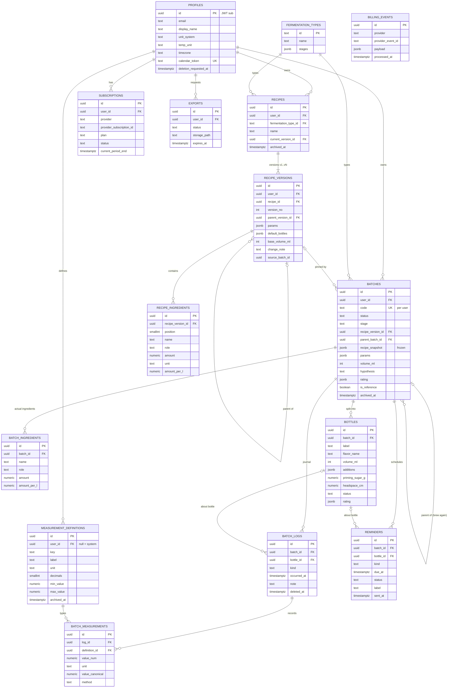
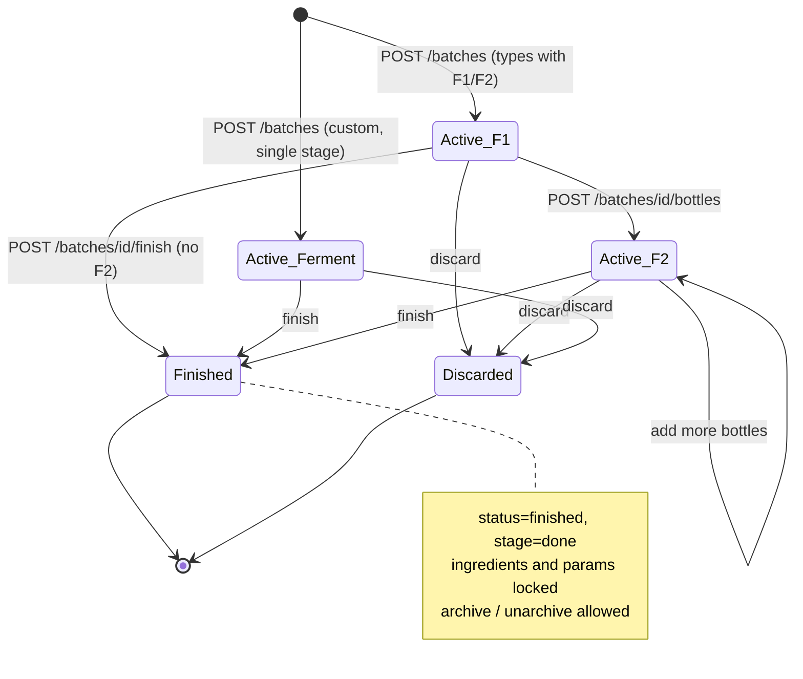
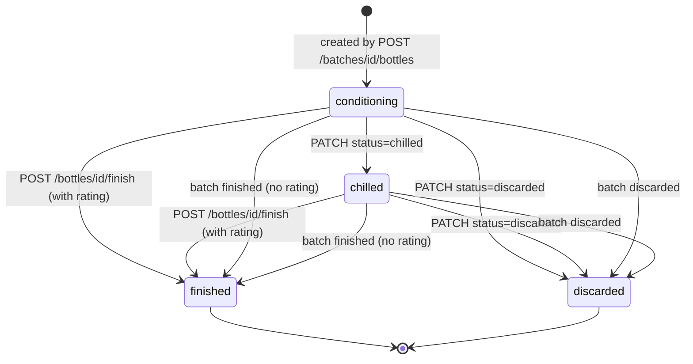

# Domain Model

Status: draft, 2026-11-05. Labels: **[Blueprint]** reused decision, **[Assumption]** proposed here, **[Contract]** fixed by the shared API contract (`docs/api/openapi.yaml`).

## 1. Ubiquitous language

| Term | Meaning |
|---|---|
| Batch | One F1 (or single-stage) ferment in one vessel. Has a code such as `KB-014`. |
| Bottle | One F2 container split from a batch. Each bottle is its own experiment (flavour, additions, priming sugar, headspace, rating). Stored as `batch_splits` in the blueprint. |
| Recipe | A named container ("Ginger fizz") with a lineage of versions. |
| Recipe version | An immutable, complete copy of recipe-level fields (v1..vN). |
| Snapshot | A frozen copy of the recipe version a batch was created from, stored on the batch. |
| Deviation | A batch-level difference from its snapshot (volume, vessel, room temperature, starter source). Never creates a version. |
| Hypothesis | "What are you changing and why?" text attached to a Brew Again batch. |
| Reference batch | A batch the user marked as the golden standard (`isReference`), or the automatic "last good batch". |
| Diff | Rows describing how two snapshots differ. Compare is a diff of 2..6 items. |

## 2. Entities

| Entity | Purpose | Owner | Mutability |
|---|---|---|---|
| User / Profile | Identity (`id` = JWT `sub`), email, preferences (`unitSystem`, `tempUnit`, `timezone`), calendar token | Self | Mutable |
| FermentationType | System template: `kombucha`, `water_kefir`, `custom`, with stages and typical days | System | Read-only seed |
| Recipe | Name, type, archive flag, pointer to latest version | User | Mutable (name, archive only) |
| RecipeVersion | Ingredients, recipe params, default bottles, change note, parent, source batch | User | **Immutable** |
| Batch | Actual ingredients and params, status, stage, snapshot, parent batch, hypothesis, rating | User | Mutable until closed, then locked except listed fields |
| Bottle | F2 experiment within a batch | User | Mutable until finished/discarded |
| LogEntry (BatchLog) | Timestamped observation for a batch or one bottle | User | **Append-only** with soft delete |
| MeasurementDefinition | Typed numeric measurement (`ph`, `temp`, `brix`, `sg` system; custom per user) | System or user | Mutable label/range; key fixed; unit fixed once used; archived instead of deleted when used |
| Measurement | Value + unit + method attached to a LogEntry | User | Append-only (hidden with its log entry) |
| Reminder | Scheduled nudge (taste check, bottle, burp, chill, custom) | User | Mutable status/dueAt/label |
| Subscription | MoR subscription state per provider subscription | User (written by system) | Written only by webhook processing |
| BillingEvent | Raw provider webhook for idempotency and replay | System | **Append-only** (`processed_at` set once) |
| Export | Asynchronous export job and its file | User | Status transitions only |
| AuditEvent [Assumption] | Record of security-relevant operations | System | **Append-only** |

## 3. ER diagram

Every user-owned table carries `user_id`. Child tables reference parents through composite foreign keys `(parent_id, user_id)` so a row can never point at another user's data [Blueprint].



Support tables not drawn: `batch_code_counters`, `idempotency_keys`, `jobs`, `audit_events`, `photos` (P1), `push_subscriptions` (P1).

## 4. Ownership

- Every row except `fermentation_types`, system `measurement_definitions` (`user_id` null) and `billing_events` has a non-null `user_id`.
- The API derives `user_id` only from the verified JWT `sub`. It never accepts `userId` in a request body or query.
- Every query filters by `user_id`. A miss (absent or another user's id) returns 404 `not_found` [Contract].
- `billing_events` are attributed to a user only after processing (via the subscription's custom data / customer id).

## 5. Lifecycles

### 5.1 Batch

`status` and `stage` are two fields [Contract]. `archivedAt` is a separate visibility flag.



| State | `status` | `stage` |
|---|---|---|
| Active_F1 | `active` | `f1` |
| Active_F2 | `active` | `f2` |
| Active_Ferment | `active` | `f1` (see unresolved question on the `ferment` stage) |
| Finished | `finished` | `done` |
| Discarded | `discarded` | unchanged from when discarded [Assumption] |

Rules:
- Finished and discarded are terminal. There is no reopen in the MVP [Assumption].
- Archive and unarchive are allowed only for `finished` or `discarded` batches [Assumption]; otherwise 409 `invalid_state_transition`.
- The blueprint's `planned` status is not in the contract and is dropped for the MVP.
- Every stage change writes a server-generated `stage_change` log entry.

### 5.2 Bottle



- Moving to `chilled` dismisses the bottle's pending burp reminders [Assumption].
- Finishing the last open bottle does not finish the batch automatically; the frontend may prompt the user [Assumption].

### 5.3 Other lifecycles

- **Reminder:** `pending -> done | dismissed | snoozed`; `snoozed -> pending` when re-scheduled via PATCH `dueAt`, or `done | dismissed`. A snoozed reminder with `dueAt <= now` is delivered like a pending one. Delivery (`sent_at`, `attempts`, `last_error`) is tracked in separate columns, not in `status`.
- **Export:** `queued -> running -> ready -> expired`, or `-> failed`.
- **Subscription:** provider statuses `trialing | active | past_due | canceled | paused` stored verbatim [Blueprint].

## 6. Mutable, immutable and append-only records

| Record | Class | Mechanism |
|---|---|---|
| `recipe_versions`, `recipe_ingredients` | Immutable | No update/delete path in the API; `BEFORE UPDATE OR DELETE` trigger raises (deletion only via account-deletion cascade with a session flag) [Blueprint trigger, extended] |
| `batches.recipe_snapshot`, `batches.recipe_version_id` (once set) | Immutable | `batches_guard` trigger [Blueprint] |
| `batches` (other fields) | Mutable then locked | Use-case checks; finished/discarded allow only `name`, `vessel`, `isReference`, `params.roomTempC`, `archivedAt` |
| `batch_ingredients` | Immutable after creation | Contract has no edit endpoint (see unresolved questions) |
| `batch_logs`, `batch_measurements` | Append-only + soft delete | No edit endpoint; `deleted_at` set once |
| `billing_events`, `audit_events` | Append-only | Insert only; `processed_at` set once |
| `bottles`, `reminders`, `recipes`, `profiles`, `measurement_definitions` | Mutable | Validated PATCH |
| `fermentation_types`, system definitions | Read-only | Seeded by migration |

## 7. Domain invariants

1. A recipe version is immutable. There is no update or delete through the API. Attempts return 409 `recipe_version_immutable`.
2. Version numbers are gap-free and sequential per recipe (`unique(recipe_id, version_no)`), allocated while holding a row lock on the recipe.
3. A new version's `parentVersionId` is the version it was derived from (which may be older than the latest; lineage can branch, numbering stays linear).
4. A batch's `recipeSnapshot` is written once at creation and never changed. A batch created without a recipe has no snapshot, ever.
5. `batch.recipeVersion` may change only from null to a value (Save as Recipe on that batch). It is never re-pointed.
6. A batch's recipe-level fields always equal its pinned version's recipe-level fields, scaled to the batch volume. This follows from the version rule (§8.3) plus invariant 9.
7. Batch codes are unique per user (`unique(user_id, code)`), generated server-side as `<PREFIX>-<NNN>` with a per-user, per-prefix counter. Codes are never reused, even after discard. Prefixes: `KB` kombucha, `WK` water kefir, `CU` custom [Assumption for WK/CU].
8. Cross-tenant references are impossible: every child FK is composite `(parent_id, user_id)`.
9. Batch ingredients are fixed at creation. Once a batch is `finished` or `discarded`, only `name`, `vessel`, `isReference`, `params.roomTempC` and archive state may change.
10. A bottle belongs to exactly one batch for its whole life and cannot be moved.
11. A bottle cannot outlive its batch: when the batch finishes or is discarded, every open bottle is closed in the same transaction.
12. Bottles can be created only while the batch is `active`, its type has an `f2` stage, and its stage is `f1` or `f2`.
13. `bottle.startedAt >= batch.startedAt`; `finishedAt >= startedAt` for batches and bottles.
14. Bottle labels are unique within a batch.
15. Log entries reference a batch the user owns and, optionally, a bottle of that same batch.
16. `stage_change` log entries are written only by the server.
17. A measurement references a system definition or one of the user's own definitions (archived definitions remain valid for existing data but cannot be used for new measurements).
18. A `ph` measurement must have a `method`. Values must fall within the definition's `min`/`max` when set.
19. Soft-deleted log entries and their measurements are excluded from every read, diff, compare and `lastMeasurements`, but are included in exports with `deletedAt`.
20. `isReference` may be true only for a `finished` batch.
21. A rating's `overall` is 1..5 and required to finish; other dimensions are optional.
22. Free users may have at most 3 non-archived custom measurement definitions; downgrading never deletes or hides existing data.
23. Subscriptions change only through processed billing events; a `billing_events (provider, provider_event_id)` pair is processed at most once.
24. Batches and recipes are never hard-deleted except by account deletion; they are archived or discarded instead.
25. A batch and its source must share `fermentationTypeId`; a recipe and the batch saved into it must share it too.

## 8. Snapshot, version and diff semantics

### 8.1 Field classification

| Class | Fields | Diff group |
|---|---|---|
| Recipe-level | ingredients (name, role, amount per litre), `params.targetF1Days` | `ingredients`, `params` |
| Recipe default bottles | `defaultBottles[].flavorName`, `additions`, `primingSugarG` | `additions` |
| Batch-level (deviation) | `volumeMl`, `vessel`, `startedAt`, `params.roomTempC`, `params.starterSource`, name, hypothesis | `process`, `params` |
| Process (derived) | F1 days (start to bottling or finish), F2 days, bottle count, bottle `headspaceCm`, bottle `volumeMl` | `process` |
| Observed | Measurements per definition key | `measurements` |
| Result | Rating dimensions, `wouldRepeat`, off-notes | `result` |

**[Assumption]** `params.starterSource` and `params.roomTempC` are batch conditions, not recipe fields. The blueprint names room temperature as a batch condition; starter source is classified the same way because it describes where the starter came from this time.

### 8.2 Snapshot content

The snapshot is a JSON copy of the version at batch creation:

```json
{
  "schemaVersion": 1,
  "capturedAt": "2026-11-05T08:00:00Z",
  "recipe": { "id": "...", "name": "Ginger fizz" },
  "version": { "id": "...", "versionNo": 3, "baseVolumeMl": 4000 },
  "ingredients": [ { "name": "Black tea", "role": "tea", "amount": 16, "unit": "g", "amountPerL": 4 } ],
  "params": { "targetF1Days": 9 },
  "defaultBottles": [ { "flavorName": "Ginger", "additions": [], "primingSugarG": 4 } ]
}
```

It is self-contained so history and exports survive even if the version row disappears. `GET /v1/batches/{id}/snapshot` returns it with derived `deviations` (diff of snapshot vs batch actuals).

### 8.3 Version rule (Brew Again and create-from-recipe)

Derived from the blueprint rule: "If the user changes recipe parameters or ingredients, the server creates a new version and the new batch points to it. If only batch conditions change (room temperature, notes), the version does not change and the difference is recorded as a batch deviation."

Applied in one database transaction on `POST /v1/batches`:

1. **No `source`:** no recipe link, no snapshot, `parentBatchId = null`.
2. **`source = {type:'recipe_version', id: V}`:** load V (404 if not owned). Compare the draft's recipe-level fields with V (§8.4 normalization).
   - No recipe-level difference: pin the batch to V; snapshot = V.
   - Any recipe-level difference: lock the recipe row, create version `max(versionNo)+1` with `parentVersionId = V`, ingredients and `targetF1Days` from the draft, `defaultBottles` copied from V, `baseVolumeMl = draft.volumeMl`, `changeNote = hypothesis`, `sourceBatchId = new batch id`. Pin the batch to it; snapshot = the new version.
3. **`source = {type:'batch', id: B}`:** set `parentBatchId = B`.
   - If B has a recipe version V, apply step 2 against V.
   - If B has none, no version is created; differences are visible only through diffs against B.
4. Batch-level differences never create a version. They are derivable at any time as deviations (snapshot vs actuals) and as the diff against the parent batch.
5. Archived recipes may still be brewed; the recipe stays archived [Assumption].
6. The user does not choose; they see "Recipe v3 - 1 change" in the UI [Blueprint].

### 8.4 Normalization before diffing

- Ingredients are matched by `(role, normalized name)`; normalized name = lowercase, trimmed, internal whitespace collapsed. Row key: `ingredients.<role>.<slug>`.
- Mass and volume amounts are converted to per-litre values (`g/L`, `ml/L`) using the batch or version volume, so a 4 L and an 8 L batch of the same recipe do not differ. Non-convertible units (for example "bags") are compared as raw `amount unit` strings.
- Numeric equality uses the display precision: ingredient per-litre values rounded to 1 decimal, measurements to the definition's `decimals` [Assumption].
- Values are expressed in the requesting user's unit preferences (`tempUnit`, `unitSystem`) in the response; stored canonical values are metric (°C, g/L) [Blueprint].

### 8.5 DiffRow construction

- `values[i]` aligns with the i-th item (`CompareResult.items[i]`, or `[base, draft]` for diff-preview, `[from, to]` for recipe diffs).
- `direction[0]` is always `null`. For i > 0: `up`, `down` or `same` relative to `values[0]` when both are numbers; `null` when either is null or non-numeric.
- `differs` is true when any value differs from any other after normalization (null vs a value counts as a difference).
- `changeCount` = number of rows with `differs = true`.
- Row order: group order `ingredients, params, additions, process, measurements, result`, then by key.
- `onlyDifferences = true` removes rows with `differs = false`.

| Group | Example keys |
|---|---|
| ingredients | `ingredients.sugar.cane_sugar` (g/L), `ingredients.starter.starter_tea` (ml/L) |
| params | `params.targetF1Days`, `params.roomTempC`, `params.starterSource` |
| additions | `additions.ginger` (bottle items; value like "15 ml juice"), `additions.primingSugarG` |
| process | `process.volumeMl`, `process.f1Days`, `process.f2Days`, `process.bottleCount`, `process.headspaceCm` |
| measurements | `measurements.ph.last`, `measurements.ph.first`, `measurements.temp.last` |
| result | `result.overall`, `result.fizz`, `result.sweetTart`, `result.flavor`, `result.wouldRepeat`, `result.offNotes` |

Compare item rules: a bottle item inherits ingredients and params from its batch, contributes its own additions, process, measurements (bottle-scoped log entries) and rating. A batch item with bottles contributes batch-level rows only; compare individual bottles to see bottle differences.

### 8.6 Reference batch ("last good batch")

For batch X, `GET /v1/batches/{id}/reference` returns the first match, excluding X itself and only `finished` batches started before X:
1. a batch marked `isReference` with the same recipe (most recent);
2. the most recent batch of the same recipe with `rating.overall >= 4` [Blueprint threshold];
3. steps 1-2 with the same fermentation type instead of the same recipe;
4. otherwise `batch: null`.

## 9. Storage mapping to the blueprint schema

| Domain (contract) | Blueprint table | Changes from the blueprint DDL |
|---|---|---|
| User/Profile | `profiles` | No FK to `auth.users` (the API may not share a database with the auth provider). Add `email`, `deletion_requested_at`, `calendar_rotated_at`. `brews`/`onboarded_at` kept but not in the contract yet. |
| FermentationType | `fermentation_types` | `stages[].expected_days` exposed as `typicalDays`. Stage keys `f1`, `f2`, `ferment`. |
| Recipe | `recipes` | Unchanged. |
| RecipeVersion | `recipe_versions` + `recipe_ingredients` | `created_from_batch_id` → `sourceBatchId`. Add `default_bottles jsonb` and `base_volume_ml`. `changed_fields` kept as a cached diff. Ingredient `role` vocabulary changes to `water, tea, sugar, starter, flavor, other` [Contract]. Writes move from the `create_recipe_version` RPC into an API transaction (the RPC used `auth.uid()`, which does not exist for an API connection). |
| Batch | `batches` + `batch_ingredients` | `current_stage` → `stage` (`f1, f2, done`). Status enum drops `planned`. Add `archived_at`, `vessel`, `bottled_at`, `discard_reason`. `rating_overall`/`ratings`/`would_repeat`/`outcome_note` map to `Rating` (`overall`, `fizz`, `sweetTart`, `flavor`, `offNotes`, `wouldRepeat`, `note`). |
| Bottle | `batch_splits` | **Rename to `bottles`** [Assumption]. `label` split into `label` ('A') and `flavor_name`. `headspace_mm` → `headspace_cm numeric`. `ended_at` → `finished_at`. Own status enum `conditioning, chilled, finished, discarded`. |
| LogEntry | `batch_logs` | `event` → `kind` (`measurement` → `measure`; `photo` deferred to P1). `split_id` → `bottle_id`. `body` → `note`. Add `idempotency_key`. `edited_at` unused (no edit endpoint yet). |
| Measurement | `batch_measurements` | `log_id` becomes required (every measurement arrives inside a log entry). `value_text` and non-numeric kinds unused in MVP (contract values are numbers). `calibrated_at` kept, not yet in the contract. |
| MeasurementDefinition | `measurement_definitions` | `canonical_unit` → `unit`. Add `decimals`. `kind` fixed to `numeric` in MVP. System seed in MVP: `ph`, `temp`, `brix`, `sg` [Contract]; blueprint extras (`salt_pct`, `weight_g`, `firmness`) deferred with P1 templates. |
| Reminder | `reminders` | Add `kind`, `bottle_id` (composite FK), `snoozed_at`, `last_error`. `title` → `label`. Status vocabulary becomes `pending, done, snoozed, dismissed`; blueprint `sent/failed` move to `sent_at`/`attempts`/`last_error`; `cancelled` maps to `dismissed`. |
| Subscription | `subscriptions` | Provider check limited to `paddle, creem, polar` (Dodo not planned). |
| BillingEvent | `billing_events` | Add `user_id` (nullable, set on processing), `attempts`, `last_error`. |
| Export | — (blueprint streamed synchronously) | New `exports` table: `status`, `storage_path`, `created_at`, `completed_at`, `expires_at`. |
| — | — | New: `batch_code_counters (user_id, prefix, last_no)`, `idempotency_keys (user_id, key, request_hash, status, response, created_at)`, `jobs`, `audit_events`. |
| Photo (P1) | `photos` | Unchanged; storage path `{user_id}/{batch_id}/{uuid}.webp` [Blueprint]. |
