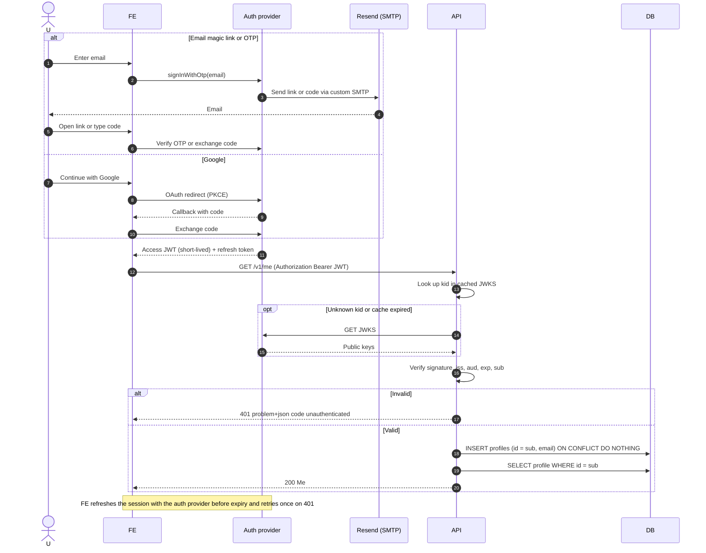
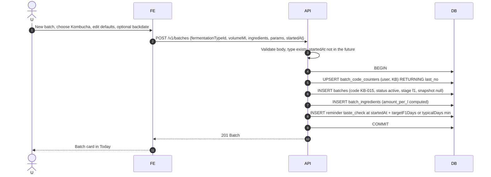
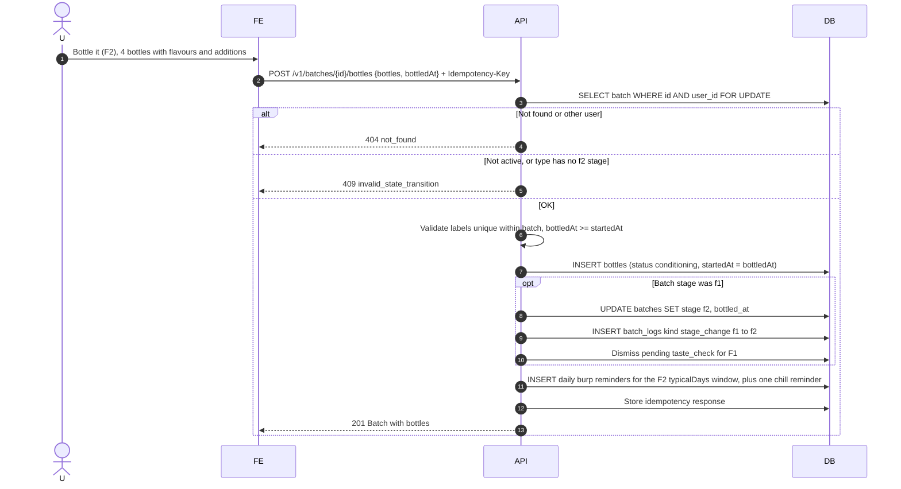
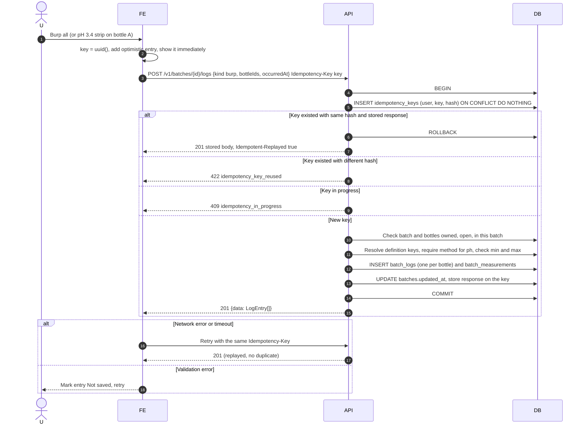
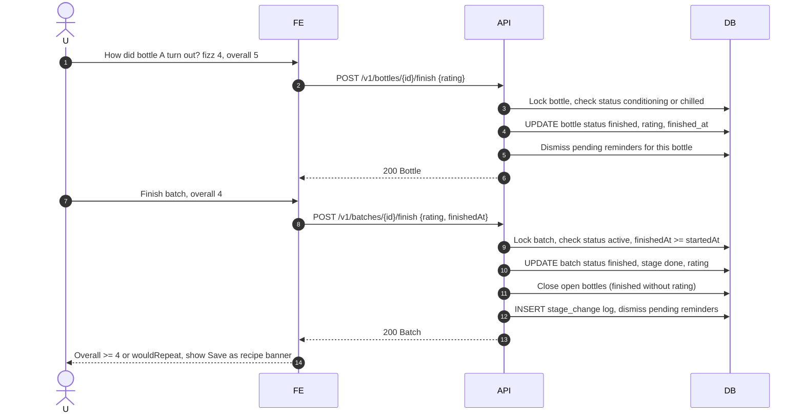
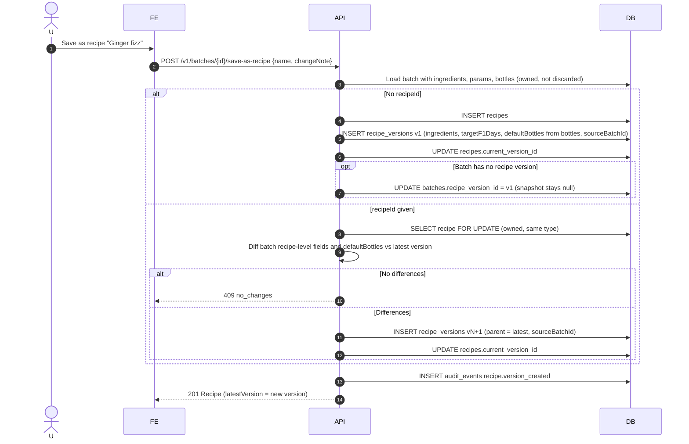
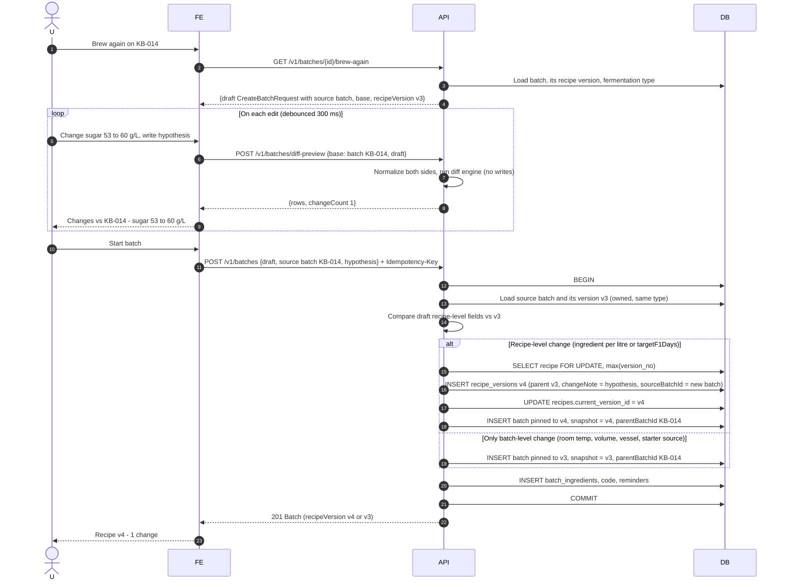
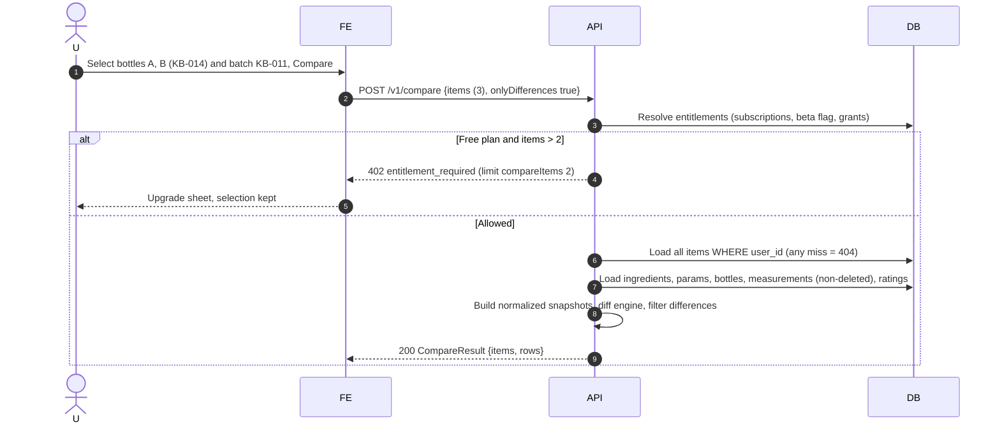
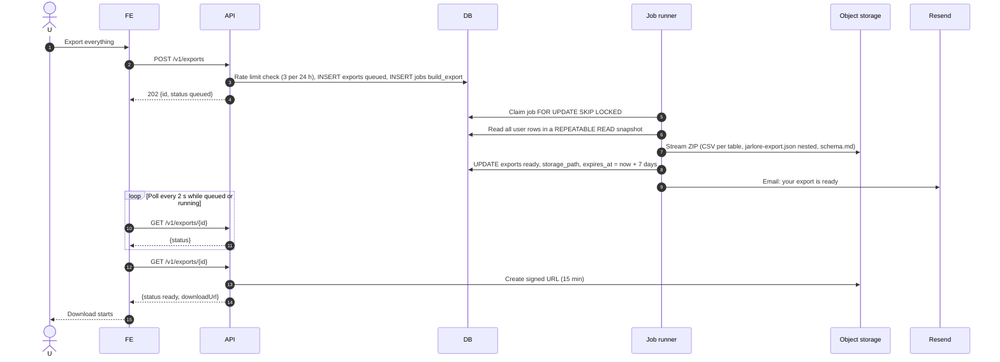
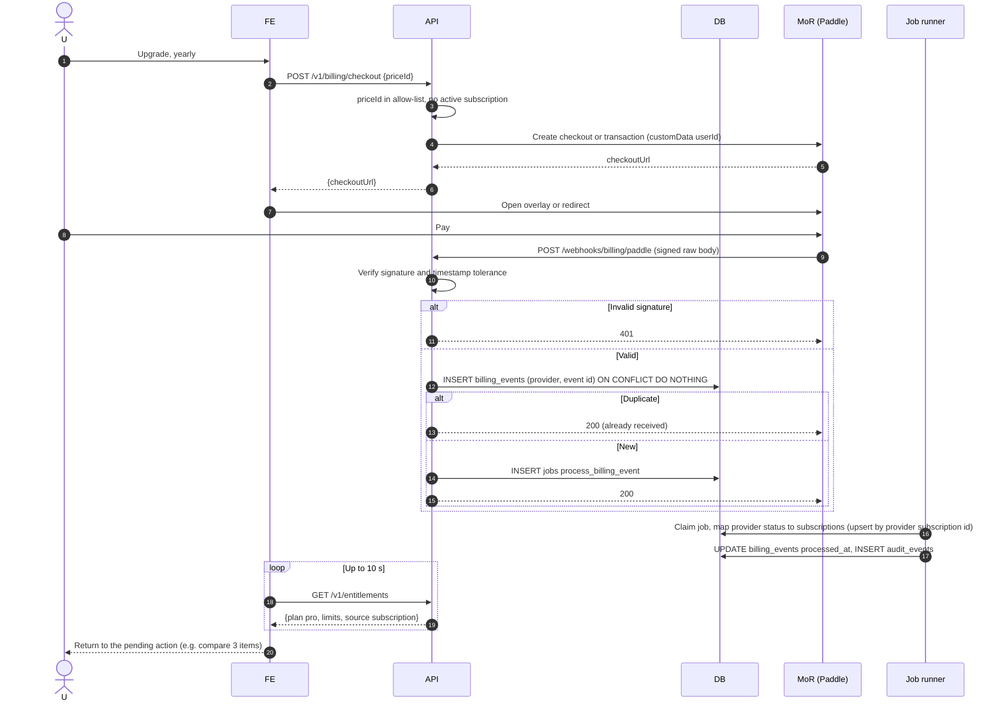

# Sequences

Participants: **U** user, **FE** Next.js frontend, **AP** auth provider (proposed Supabase Auth), **API** Jarlore API, **DB** PostgreSQL, **J** job runner (same codebase as the API), **S** object storage, **M** Resend, **MoR** billing provider. Every API-to-DB write in a request runs in one transaction unless noted.

## 1. Authentication

Magic link / OTP or Google OAuth happens between the frontend and the auth provider. The API only verifies the resulting JWT.

## 2. Create F1 batch

## 3. Split F1 into F2 bottles

## 4. Record bottle observation (optimistic and idempotent)

## 5. Finish and rate an experiment

## 6. Save the result as a recipe

## 7. Brew Again (draft, diff-preview, create)

## 8. Compare experiments with the entitlement check

## 9. Export user data

## 10. Subscription checkout and webhook synchronisation

Out-of-order events are handled by comparing the provider's event timestamp (or subscription `updated_at`) with the stored one and ignoring older updates [Assumption].
