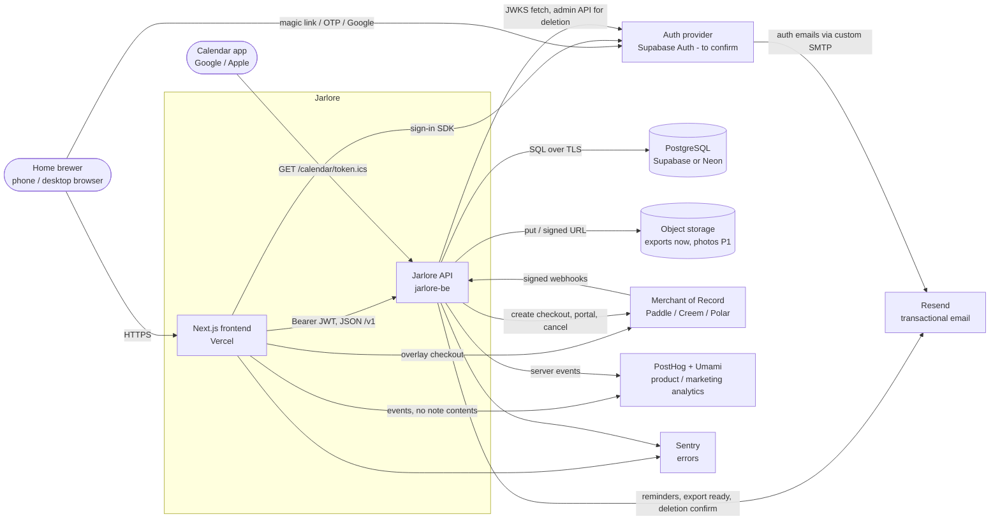
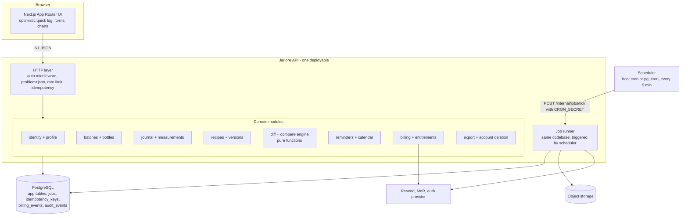
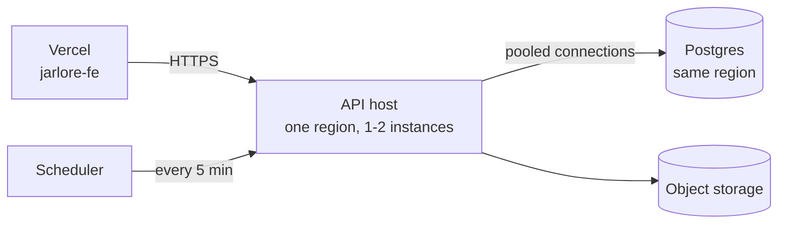

# System Overview

Status: draft, 2026-11-05. Source of product truth: the "Fermentation Lab" blueprint (product renamed Jarlore). Labels used below: **[Blueprint]** reused decision, **[Assumption]** not decided by the blueprint or founder, **[Decision to confirm]** proposed default awaiting founder sign-off.

## 1. What changed since the blueprint

The blueprint proposed one Next.js monolith talking to Supabase directly, with Row Level Security (RLS) as the main authorization layer. The founder has since created a separate backend repository. The architecture is now:

```
Next.js frontend (jarlore-fe)  ->  Jarlore API (jarlore-be, HTTP JSON, /v1)  ->  PostgreSQL
```

The browser never talks to the database. The API is the single authority for ownership, recipe version integrity, batch snapshot and experiment integrity, validation, entitlements, diffs, comparisons and history. See ADR-001.

## 2. System context



## 3. Containers

The API is one deployable process (a modular monolith). Background work runs in the same codebase, triggered by a scheduler, against a Postgres job table. No microservices and no message broker.



Module rules **[Assumption]**:
- Modules call each other through plain in-process interfaces, never through HTTP.
- Only `recipes` writes `recipe_versions`. Only `billing` writes `subscriptions` and `billing_events`.
- `diff` has no I/O. It takes two normalized snapshots and returns `DiffRow[]`. It is the most heavily unit-tested module. [Blueprint: "diff engine ... pure function ... with unit tests"]

## 4. Responsibilities: frontend vs backend

| Concern | Frontend (jarlore-fe) | Backend (jarlore-be) |
|---|---|---|
| Sign-in UI, session refresh | Owns (auth provider SDK) | Verifies the JWT on every request |
| Rendering, navigation, charts, unit display formatting | Owns | Provides values and units |
| Form UX validation (required fields, ranges) | Mirrors for fast feedback only | **Authoritative** |
| Optimistic quick log | Owns the optimistic state and retry UI | Idempotent writes via `Idempotency-Key` |
| Live diff in Brew Again | Displays rows | Computes rows (`POST /v1/batches/diff-preview`) |
| Upgrade prompts | Shows the sheet on 402 `entitlement_required` | Decides the plan and limits |
| Checkout | Opens the MoR overlay/URL | Creates the checkout, consumes webhooks |
| Analytics | Client events (no note text) | Server events for key state changes |

### Business rules that live ONLY in the backend

The frontend may display hints, but it must not be trusted to enforce any of these.

| # | Rule | Enforced where |
|---|---|---|
| B1 | Every read and write is scoped to the JWT subject; other users' resources are 404 | Query layer + composite FKs |
| B2 | Recipe versions are immutable; new versions are created only by the version rule or Save as Recipe | Recipes module + DB trigger |
| B3 | Version rule on batch creation: recipe-level change creates version n+1; batch-level change is a deviation | Batches module (single transaction) |
| B4 | The recipe snapshot is frozen at batch creation | Batches module + DB trigger |
| B5 | Batch codes (`KB-014`) are generated per user and type prefix, unique, never reused | Batches module + unique index |
| B6 | Batch and bottle state transitions (see DOMAIN_MODEL.md) | Batches module |
| B7 | Ingredients are fixed after creation; a finished or discarded batch is locked except name, vessel, isReference, params.roomTempC | Batches module |
| B8 | A bottle belongs to exactly one batch and cannot stay open after the batch closes | Batches module |
| B9 | Measurements must reference a system or own definition; pH requires a method; value within definition min/max | Journal module |
| B10 | Entitlements: compare items (2 free / 6 Pro), custom measurement definitions (3 free), non-adjacent recipe diffs (Pro) | Billing module, checked in each use case |
| B11 | Diffs, comparisons, reference-batch selection, averages (`avgOverall`, `batchCount`) | Diff + recipes modules |
| B12 | Reminder generation from stages (taste check, daily burps, chill) and cancellation on finish/discard | Reminders module |
| B13 | Subscription state comes only from verified, de-duplicated webhooks | Billing module |
| B14 | Export content and account deletion scope | Export module |
| B15 | No output ever labels a ferment safe, ready, done-to-drink or passed | Copy review + label vocabulary in reminders |

## 5. Background jobs

All jobs use a `jobs` table claimed with `SELECT ... FOR UPDATE SKIP LOCKED` (ADR-010). A scheduler calls one internal tick every 5 minutes; long-running hosts may also run an in-process poll loop.

| Job | Trigger | Work | Retry |
|---|---|---|---|
| `dispatch_reminders` | Every 5 min [Blueprint] | Up to 200 due reminders (pending, or snoozed with `dueAt <= now`), one digest email per user per run via Resend, set `sent_at` | 3 attempts, then `last_error` set [Blueprint] |
| `process_billing_event` | Enqueued by webhook handler | Apply event to `subscriptions` | Exponential backoff, 8 attempts [Assumption] |
| `build_export` | `POST /v1/exports` | Stream CSV per table + nested JSON into a ZIP, upload, mark ready | 3 attempts |
| `delete_account` | Confirmed `DELETE /v1/me` | Cancel subscription at MoR, delete storage objects, delete rows, delete auth identity | Retried until done; alerts on failure |
| `purge_expired` | Daily | Delete idempotency keys > 24 h, export files > 7 days, finished job rows > 30 days | n/a |

## 6. External integrations

| Integration | Direction | Purpose | Notes |
|---|---|---|---|
| Auth provider (default Supabase Auth) | FE signs in; API reads JWKS; API calls admin API on deletion | Identity | Custom SMTP through Resend is mandatory: the built-in sender is limited to 2 emails/hour per project [Blueprint] |
| PostgreSQL (Supabase or Neon) | API only | System of record | ADR-004 |
| Resend | API out | Reminder digests, export ready, deletion confirmation | Digest per user keeps volume low [Blueprint] |
| MoR (Paddle primary, Creem fallback, Polar second fallback) | Both | Checkout, portal, subscription webhooks | Behind a provider interface `createCheckout`, `parseWebhook`, `portalUrl` [Blueprint]. Avoid Lemon Squeezy [Blueprint] |
| Object storage | API out, browser downloads via signed URL | Export ZIPs; photos in P1 | Supabase Storage or any S3-compatible store |
| PostHog / Umami | FE and API out | Funnel: signup, first batch, second log, finish, brew again, compare, upgrade [Blueprint] | Never send note text or measurement notes |
| Sentry | FE and API out | Errors | Scrub `Authorization`, calendar tokens, request bodies |

## 7. Deployment sketch



- **[Assumption]** Run the API as a container on a small PaaS (for example Fly.io, Railway or Render) in the same region as the database. A long-running process keeps connection pooling and the job loop simple. A serverless target (Vercel Functions, Cloudflare Workers) is possible if the framework chosen in ADR-002 supports it; then the scheduler must be the host cron or pg_cron calling the tick endpoint.
- Place the API on a subdomain (for example `api.<domain>`), CORS-restricted to the frontend origin.
- Migrations run from CI or manually against `DATABASE_URL_DIRECT` before deploy. The tool is not chosen yet (see unresolved questions).
- Environments: local, staging (optional until beta), production.

## 8. Cost note

The blueprint estimated **~$0-1/month** in private dev, **~$45-65/month** at 1,000 users and **~$65-100+/month** at 10,000 users (Supabase Pro $25, Vercel Pro $20, Resend free tier then $20, PostHog/Sentry free), excluding MoR fees.

The separate API adds one host. **[Assumption, prices not verified]** A small always-on container costs roughly $5-20/month, so expect about **$50-85/month** at 1,000 users. Two notes:
- Supabase Free pauses after one week of inactivity, which would stop reminders, so move to Pro ($25) before public beta [Blueprint].
- If Postgres moves to Neon, Supabase may still be used for Auth only (free tier limits to verify), and storage moves to an S3-compatible bucket.
