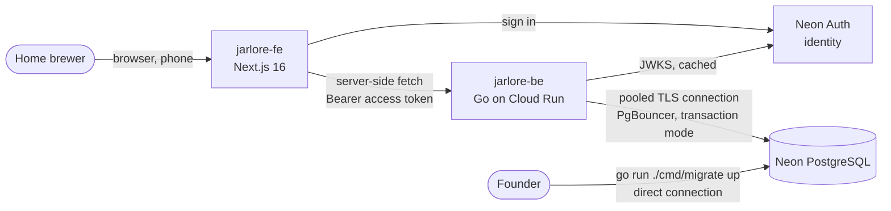

# System Overview

Status: implemented, 2026-11-07. Go API on Google Cloud Run, Neon PostgreSQL and Neon Auth (one vendor for data and identity).

## 1. Decisions in one table

| Concern | Decision | Where |
|---|---|---|
| Language and framework | Go 1.27, standard `net/http` + chi router | ADR-002 |
| Database | Neon PostgreSQL, the only primary database (Postgres 18 by default on new Neon projects; tests run on 17) | ADR-004, [DATABASE_DESIGN.md](DATABASE_DESIGN.md) |
| Data access | SQL first: goose migrations, sqlc-generated queries, pgx/v5 + pgxpool | [DATABASE_DESIGN.md](DATABASE_DESIGN.md) |
| Identity | Neon Auth (Managed Better Auth) issues EdDSA access tokens; the API verifies them against the JWKS | ADR-003, [SECURITY.md](SECURITY.md) |
| Isolation | Ownership in every query, composite foreign keys, row level security, restricted runtime role | ADR-011 |
| Hosting | Google Cloud Run, request-based billing, 0 to 2 instances | ADR-012, [CLOUD_RUN.md](../deployment/CLOUD_RUN.md) |
| Contract | `api/openapi.yaml` (OpenAPI 3.1). Contract tests validate real responses; the frontend generates its types from it | ADR-013, [API_CONTRACT.md](API_CONTRACT.md) |

## 2. Context



- The browser never calls the API with a token held in JavaScript: Next.js server components and server actions call it, reading the token from an httpOnly cookie.
- Only the API talks to Jarlore's tables. Neon Auth keeps users and sessions in the `neon_auth` schema of the same database; the API role has no access to it.

## 3. Inside the API

```
cmd/api            HTTP server: config, pool, verifier, graceful shutdown (SIGTERM)
cmd/migrate        goose migrations over DIRECT_DATABASE_URL (up, status; no down)
cmd/devauth        LOCAL ONLY: signs EdDSA tokens like Neon Auth so the real verification path runs
internal/config    environment, validated at startup
internal/api       router, middleware (request id, logging, recover, CORS, timeout, auth), thin handlers
internal/app       use cases: one transaction each, ownership checks, idempotency, read models
internal/domain    pure rules: units, the diff engine, the recipe version rule (no I/O)
internal/db        pool, per-user transaction (RLS context), error mapping; sqlc code in db/sqlc
internal/auth      JWT verification against the JWKS
internal/httpx     JSON, problem+json, strict body decoding
db/migrations      SQL schema, triggers, RLS, seed data
db/queries         SQL for sqlc
api/openapi.yaml   the contract (embedded and served at /openapi.yaml)
```

Request path: `requestID → logRequests → recover → securityHeaders → CORS → timeout → authenticate (/v1 only) → handler → app.Service → db.Store.UserTx → sqlc queries`.

Every use case runs in **one** transaction that first calls `set_config('jarlore.user_id', <sub>, true)`. The setting is transaction-local, so it is safe with Neon's transaction-mode pooler and can't leak to the next request on the same connection (tested).

## 4. Responsibilities

| Rule | Owner |
|---|---|
| Who the user is | Neon Auth (token), verified by the API |
| Ownership, isolation | API (queries) and PostgreSQL (composite FKs, RLS) |
| Batch codes, versions, snapshots, changed fields | API, inside the write transaction |
| Diffs, "what changed", unit normalisation | `internal/domain` (server only) |
| Entitlements (compare limit, custom measurements) | API (`/v1/entitlements` drives the UI) |
| Validation | API (independent of any frontend checks) |
| Where the highlight goes in a table | Frontend only |

## 5. Background work

None runs today. Reminders are rows that Today reads; nothing is sent. The API keeps no background goroutines besides the hourly JWKS refresh, so an idle instance and an idle Neon compute both scale to zero. When reminder emails arrive (P1), use Cloud Scheduler calling an internal endpoint (ADR-010), not a resident worker.

## 6. Environments

| Environment | API | Database | Auth |
|---|---|---|---|
| Local | `go run ./cmd/api` on :8080 | Local PostgreSQL set up like Neon (`scripts/local-db.sql`) or a Neon dev branch | `go run ./cmd/devauth` |
| Tests | `httptest` with the real router | A fresh database per test package (`JARLORE_TEST_DATABASE_URL`) | Test ES256 key |
| Production | Cloud Run `asia-southeast1` | Neon `aws-ap-southeast-1` (Singapore) | Neon Auth (same project) |

## 7. Cost model

Everything runs on free allowances at low volume, with real limits (details and sources in [CLOUD_RUN.md](../deployment/CLOUD_RUN.md) and [NEON_SETUP.md](../deployment/NEON_SETUP.md)):

- Cloud Run: 180,000 vCPU-seconds, 360,000 GiB-seconds and 2 million requests a month per billing account, credited at Tier 1 prices (Singapore is Tier 2, so the allowance covers fewer seconds there). A billing account is required.
- Neon Free: 100 CU-hours a month per project, autoscaling up to 2 CU, 1 GB storage per project, scale to zero after 5 idle minutes (cannot be disabled on Free).
- Budget alerts notify; they do not stop spending.
